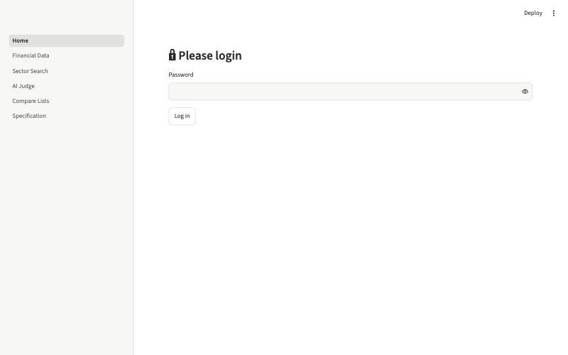
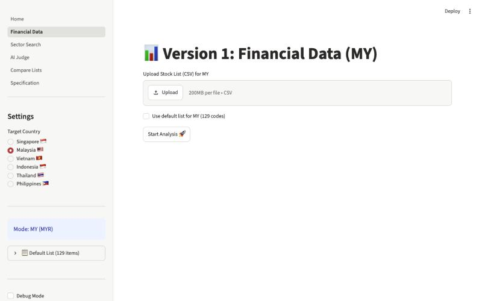
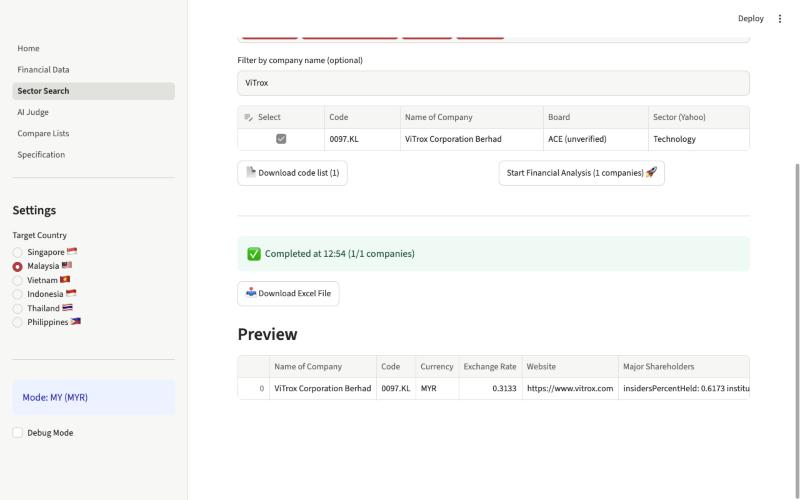
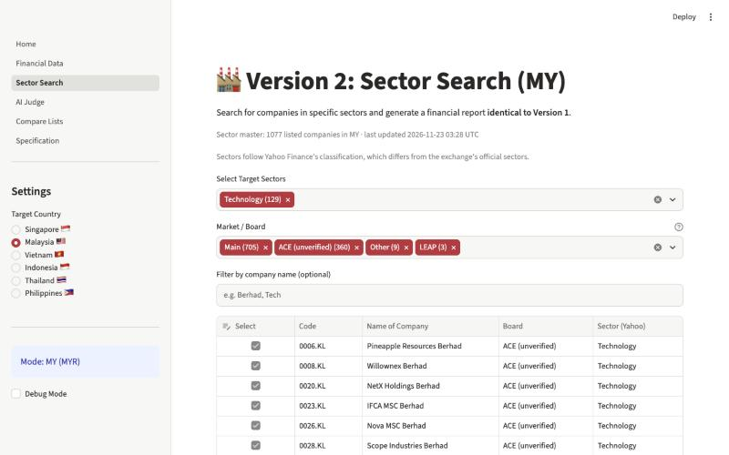
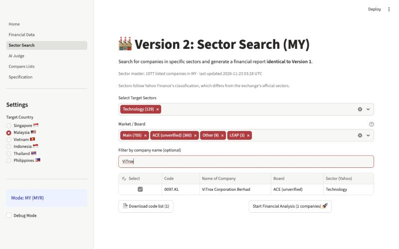
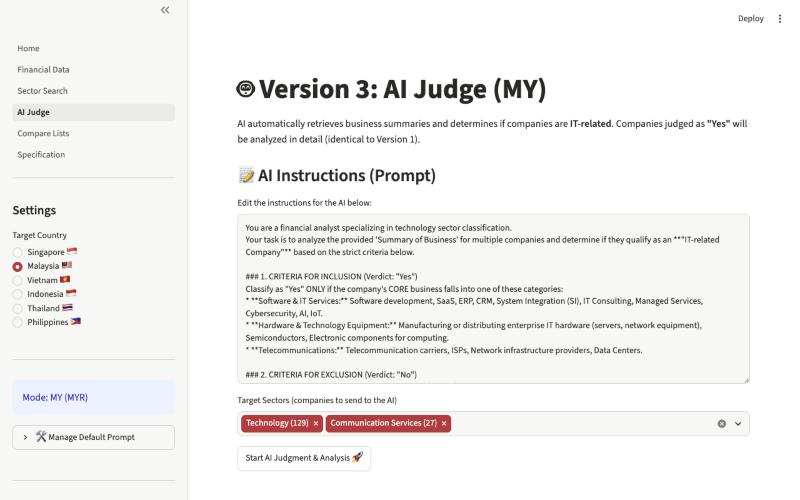
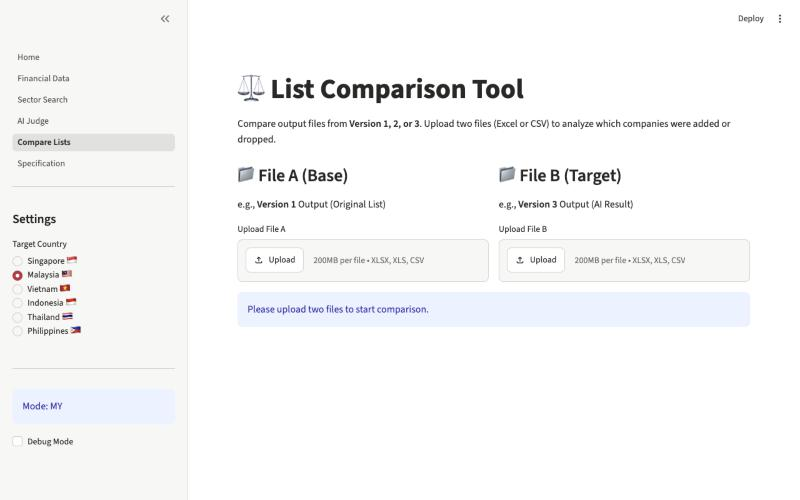

# ASEAN Stock Analysis Hub — User Guide

This guide explains, step by step, how to use the ASEAN Stock Analysis Hub. You don't need any technical knowledge. If you get stuck, see **9. Troubleshooting** near the end.

---

## 1. What this tool does

The tool helps you build **lists of listed companies** in ASEAN markets, for example "IT companies listed in Malaysia". It then creates an **Excel file** with each company's financial data and profile in our standard research format.

There are four tools in the menu on the left. Pick the one that matches what you want to do:

| I want to… | Use this tool |
|---|---|
| Get the Excel for a list of stock codes I already have | **Financial Data** (Version 1) |
| Find companies in a sector (e.g. all Technology companies in Malaysia) and get their Excel | **Sector Search** (Version 2) |
| Let the AI read each company's business description and pick out the IT companies | **AI Judge** (Version 3) |
| Compare two lists and see which companies were added or removed | **Compare Lists** |

The **Specification** page is the technical description of the system. You don't need it for daily use.

---

## 2. Before you start

### 2.1 Open the website

Open this address in your browser (Chrome or Edge recommended):

**https://aseanstockapp-analysis.streamlit.app/**

> 💤 **If you see "This app has gone to sleep"**: the app sleeps when nobody has used it for a while. Click **"Yes, get this app back up!"** and wait about 30–60 seconds. This is normal.

### 2.2 Log in

1. Type the password into the **Password** box. Ask Kosuke if you don't have it.
2. Click **Log in**.

You stay logged in until you close the browser tab.

### 2.3 Know the screen

Every tool page has the same layout:

- **Menu (top left):** switch between Home, Financial Data, Sector Search, AI Judge, Compare Lists and Specification.
- **Settings → Target Country (left):** choose the market you are working on.
  - The country stays selected when you move between pages.
  - The page title shows the current country, e.g. "(MY)".
- **Mode box (left):** confirms the country and currency, e.g. "Mode: MY (MYR)".
- **Main area (right):** where you do the work.
- **Debug Mode (bottom left):** leave it off. Turn it on only if Kosuke asks you to, to show technical error details.

### 2.4 Country codes

| Code | Country | Exchange | Stock code example |
|---|---|---|---|
| SG | Singapore | SGX | `D05.SI` (DBS) |
| MY | Malaysia | Bursa Malaysia | `1155.KL` (Maybank) |
| TH | Thailand | SET | `PTT.BK` |
| ID | Indonesia | IDX | `BBCA.JK` |
| PH | Philippines | PSE | `SM.PS` |
| VN | Vietnam | HOSE | `FPT.VN` |

The part after the dot (`.KL`, `.SI`…) tells the system which exchange the stock is on. You can usually leave it out; the tool adds it for the selected country.

---

## 3. Quick start: "Give me Malaysian IT companies with their financial data"

The fastest way, in about 10 minutes:

1. Open **Sector Search** from the menu.
2. Under **Target Country**, choose **Malaysia**.
3. In **Select Target Sectors**, choose **Technology**.
4. Leave **Market / Board** as it is (all markets selected).
5. Click **Start Financial Analysis**.
6. Wait until you see ✅ **Completed**, then click **📥 Download Excel File**.

Details for each step are in Section 5.

---

## 4. Financial Data (Version 1): make the Excel from your own list

Use this when you **already know which companies** you want.

### Step 1 — Choose the country

In the left sidebar, under **Target Country**, click the country, e.g. **Malaysia**.

### Step 2 — Choose the companies (A or B)

**A. Use your own list (upload a CSV file)**

1. Prepare the file in Excel:
   - Put **one stock code per row, in column A**. A header in the first row (e.g. "Code") is fine; it is ignored.
   - Example:

     | A |
     |---|
     | Code |
     | 0097.KL |
     | 0166.KL |
     | 5347.KL |

   - Click **File → Save As** and choose the type **CSV (Comma delimited) (\*.csv)**.
2. In the app, click **Upload** and choose your CSV file.

> ⚠️ **Important for Malaysian codes: leading zeros.** Excel removes leading zeros, so `0097` becomes `97`. Then the tool looks for the wrong company. To avoid this, do one of these:
> - type the full code with the suffix, e.g. **`0097.KL`** (Excel keeps it as text), or
> - format column A as **Text** *before* typing the codes.

**B. Use the default list**

- Tick **"Use default list for MY (141 codes)"**. The number of codes is shown on the box.
- To see which companies are in it, open **📋 Default List** in the left sidebar.
- If a country has no default list, the box says **"Not registered ⚠️"** and can't be ticked.
- To change a default list permanently, ask Kosuke. Changes made inside the app are not saved.

If you both upload a file **and** tick the default list, the **uploaded file is used**.

### Step 3 — Start

Click **Start Analysis 🚀**. A progress bar shows "Fetching Financial Data (5/141): 0097.KL…".

> ⏱ **How long does it take?** About **3–6 seconds per company**, plus a short AI step at the end. 10 companies take about 1 minute; 130 companies take about 10–15 minutes.
>
> 🚫 **While it is running, don't click other buttons or change settings on the page.** In this app any click restarts the page and stops the run. You can work in another browser tab or another program in the meantime.

### Step 4 — Download

When it finishes you will see the result:

- ✅ **Completed at 12:54 (1/1 companies)**: the time it finished, and how many companies were retrieved.
- ⚠️ A yellow box, if any companies could not be retrieved, listing their codes (see Section 9).
- **📥 Download Excel File**: saves the Excel, named like `Version_1_MY_2026-11-23.xlsx`.
- **Preview**: a quick look at the data. Scroll sideways to see more columns.

The result stays on the page until you close the tab. You can click Download more than once, and you can switch to other pages and come back.

---

## 5. Sector Search (Version 2): find companies by sector

Use this when you want **all companies in a sector**, e.g. every Technology company in Malaysia.

### Step 1 — Choose the country

Choose it under **Target Country** in the sidebar.

- The grey line under the title shows how many listed companies the tool knows for that country, and when the list was last updated, e.g. "1077 listed companies in MY · last updated 2026-11-23".
- The list updates automatically every morning. Newly listed companies are added, and delisted ones are removed.

### Step 2 — Select sectors

1. Click **Select Target Sectors**.
2. Choose one or more sectors. The number in brackets is how many companies each has, e.g. "Technology (141)".
3. To remove a sector, click the **×** on its red tag.

The sectors are **Yahoo Finance's 11 sectors**:

- Basic Materials
- Communication Services
- Consumer Cyclical
- Consumer Defensive
- Energy
- Financial Services
- Healthcare
- Industrials
- Real Estate
- Technology
- Utilities

They are **not the same as Bursa Malaysia's or SGX's official sectors**. For example, an IT services company may appear under "Industrials". "Unknown" means Yahoo has not assigned a sector.

> 💡 Looking for **IT companies**? Technology is the main one, but also check **Communication Services**. To be thorough, use **AI Judge** (Section 6).

### Step 3 — Market / Board (Malaysia only)

Malaysia has three markets. All of them are selected at the start.

| Board shown | Meaning |
|---|---|
| **Main** | Main Market: established, larger companies |
| **ACE (unverified)** | Usually ACE Market (growth companies). "Unverified" because a few companies that moved from ACE to Main keep their old code, so the tool can't be 100% sure. |
| **LEAP** | LEAP Market (for sophisticated investors). Most LEAP companies are included; a few have no Yahoo data and are missing. |
| **Other** | Preference shares, rights and similar instruments (not ordinary shares) |

To focus on one market, remove the others by clicking their **×**. If you remove all of them, every company is shown.

### Step 4 — (Optional) Filter by name

Type part of a company name in **Filter by company name**, e.g. `ViTrox`, and press Enter.

### Step 5 — Check the list and choose companies

- The table shows every matching company with its **Code**, **Name**, **Board** and **Sector**.
- Every row is ticked (✔) in the **Select** column. **Untick** any company you don't want.

### Step 6 — Download the list or start the analysis

- **📄 Download code list (N)** saves the ticked codes as a CSV file, e.g. `Codes_MY_2026-11-23.csv`.
  - Use it to keep a record of the list, or upload it later in **Financial Data**.
  - It takes no time.
- **Start Financial Analysis (N companies) 🚀** creates the full Excel for the ticked companies.
  - It works exactly like Financial Data (Section 4, Steps 3–4) and takes the same time.
  - The file is named like `Version_2_MY_2026-11-23.xlsx`.

> 💡 For more than about 100 companies, the tool warns you that it will take a while. Consider narrowing the list first.

---

## 6. AI Judge (Version 3): let the AI find IT companies

Sector labels alone can't reliably identify IT companies. AI Judge **reads each company's business description** and decides whether it is IT-related, following written rules. It then creates the Excel for the companies it judged **"Yes"**.

### Step 1 — Choose the country

As before, use **Target Country**.

### Step 2 — Check the AI instructions (optional)

The large box, **AI Instructions (Prompt)**, contains the rules the AI follows:

- **Yes:**
  - Software and IT services
  - IT hardware and semiconductors
  - Telecommunications
- **No:**
  - Companies that only *use* IT, such as banks with apps, online shops and general manufacturers
- **Grey:**
  - Mixed or unclear businesses

You can edit the text to change the rules for **this session only**. Use **🛠 Manage Default Prompt → Reset to System Original** in the sidebar to undo your edits. If you want a rule change to become permanent, ask Kosuke.

### Step 3 — Choose which sectors to send to the AI

**Target Sectors** starts with **Technology** and **Communication Services**. You can add more, e.g. Industrials, to catch IT companies that Yahoo classifies elsewhere. More sectors means more companies and a longer run.

### Step 4 — Start

Click **Start AI Judgment & Analysis 🚀**. It runs in three steps:

1. **Retrieving Business Summaries:** about 1 second per company.
2. **AI Analyzing:** the AI judges about 30 companies at a time. Companies judged "Yes" appear in the log with a reason, e.g. "✅ 0097.KL (ViTrox…): Hardware – …".
3. **Fetching Financial Data:** only for the "Yes" companies, as in Financial Data.

> ⏱ For about 150 companies, expect **15–25 minutes** in total.

### Step 5 — Download

As in Financial Data. The file is named like `Version_3_AI_Judge_MY_2026-11-23.xlsx`. In column **Category Classification/YahooFin**, the AI's category is shown with "(AI Judged)".

> ℹ️ The Excel contains only the "Yes" companies. "No" and "Grey" companies are not included.

---

## 7. Compare Lists: what changed between two lists?

Use this to compare, for example, last month's Excel with this month's, or a Version 1 list with an AI Judge result.

1. Under **File A (Base)**, upload the older or original file (Excel or CSV).
2. Under **File B (Target)**, upload the newer file.
   - Each file needs a column named **Code** (the Excel files from this tool already have one), or the codes in the first column.
3. The tool shows three numbers:
   - **Common:** companies in both files
   - **Only in File A:** companies that disappeared from B
   - **Only in File B:** companies that are new in B
4. To see details, choose a group under **Target Group** and click **Fetch Details for N companies**. You get each company's name, sector, industry and business summary, with an Excel download.

> ⚠️ Both files must write codes the same way. `0097.KL` and `0097` are treated as different. Use files produced by this tool for both sides when possible.

---

## 8. Understanding the Excel file

The Excel has one row per company. The first row (yellow) is the header.

### 8.1 Columns filled automatically

| Column | What it means |
|---|---|
| Ref | Row number |
| Name of Company / Code | Company name and stock code |
| **Market / Board** | Malaysia: Main / ACE (unverified) / LEAP / Other. Blank for other countries. |
| Website, Address, Contact No. | From the company profile on Yahoo Finance |
| Major Shareholders | Ownership information from Yahoo. Often percentages (insiders / institutions) rather than named shareholders. |
| Currency | The currency of the company's financial statements |
| Exchange Rate (to SGD) | Rate to convert that currency into SGD (previous day's close) |
| FY | End date of the latest financial year |
| REVENUE … ('000) and the other financial columns | From the latest **annual** financial statements, **in thousands** of the statement currency |
| Segments | Main business segments, **written by AI** from the business summary |
| Debt/Equity(%) | (Total assets − total equity) ÷ total equity, i.e. total liabilities relative to equity |
| Loan/Equity (%) | Total debt ÷ total equity |
| Stock Price (… Closing) | Previous day's closing price |
| Market Cap ('000) | Stock price × shares outstanding, in thousands |
| Summary of Business | The company's business description (English, from Yahoo) |
| Chairman / CEO | Top executive listed on Yahoo |
| Number of Employee Current | Full-time employees |
| Category Classification/YahooFin, Sector & Industry/YahooFin | Yahoo's sector and industry |

### 8.2 Columns left blank for you

These columns are empty on purpose, for your team's notes:

- Taka's comments
- Remarks
- Visited (V) / Meeting Proposal (MP)
- Access
- Last Communications
- Category Classification/ShareInvestor
- Incorporated (IN / Year)
- The official exchange classification columns (e.g. Category Classification/SGX or /Bursa), unless official data has been loaded

### 8.3 Blank cells vs. zero

- **A blank cell means Yahoo Finance has no data** for that item. For example, banks have no "Gross Profit".
- **0 means the company actually reported zero.**

### 8.4 Things to keep in mind

- All data comes from **Yahoo Finance** (and AI for Segments). It is a convenient starting point, not an audited source. Check important figures against the company's annual report.
- Figures are in **thousands** of the statement currency. To compare across countries, use the **Exchange Rate (to SGD)** column.

---

## 9. Troubleshooting

| What you see | Why | What to do |
|---|---|---|
| "This app has gone to sleep…" | Nobody used the app for a while | Click **Yes, get this app back up!** and wait 30–60 seconds. |
| "Password incorrect" | Wrong password | Check capital letters and try again, or ask Kosuke. |
| "Please upload a CSV file or select the default list." | Nothing was chosen | Upload a CSV or tick the default list (Section 4, Step 2). |
| "No valid stock codes found in the CSV…" | The file has no codes in column A, or it isn't a real CSV | Put one code per row in column A and save as **CSV (Comma delimited)**. |
| The default-list box says "Not registered ⚠️" | There is no default list for this country | Upload your own CSV, or ask Kosuke to add a default list. |
| "No company list is available for PH" (or VN) | Yahoo Finance doesn't provide a company list for this market | Use **Financial Data** with your own CSV. |
| "No companies found matching the specified sectors." | The filters exclude everything | Remove the name filter, add sectors, or re-select all boards. |
| ⚠️ "Could not retrieve data for N code(s): …" | Those companies are delisted, the code is wrong, Yahoo has no data (this happens for a few LEAP companies), or Yahoo was busy | Check the codes. If it looks like a temporary problem, click Start again a few minutes later. |
| "No data retrieved. Yahoo Finance may be limiting requests…" | Yahoo is temporarily refusing requests | Wait 5–10 minutes and click Start again. Companies already retrieved are remembered for 24 hours, so the retry is quicker. |
| The page went blank or reset in the middle of a run | You clicked something during the run, or the tab or computer went to sleep | Click Start again. Companies already retrieved come back almost instantly ("N from cache"). |
| A Malaysian company is missing from Sector Search | It may be delisted, an ETF (ETFs are excluded), or one of the few LEAP companies Yahoo has no data for | Check the code on Bursa Malaysia's website. If it is listed, add it through **Financial Data** with your own CSV. |
| The wrong company appears for a Malaysian code | Excel removed the leading zero (`0097` → `97`) | Write codes as `0097.KL`, or format the column as Text (Section 4, Step 2). |
| The "Segments" column is empty | The AI service was not available | The other columns are still correct. Try again later, or tell Kosuke. |
| Some numbers are blank | Yahoo has no data for that item | Normal; see Section 8.3. Check the annual report if needed. |
| Anything else | | Tick **Debug Mode**, repeat the action, take a screenshot of the error and send it to Kosuke. |

---

## 10. Tips

- **Start small.** Try a few companies first (use the name filter, or a short CSV) to check you get what you expect, then run the full list.
- **Keep the tab open** during long runs, and don't click on the page until you see ✅ Completed.
- **Save the code list** (Sector Search → Download code list) together with the Excel, so you know exactly which companies were included.
- **Re-running is cheap.** Data for each company is remembered for 24 hours, so running the same list again the same day is fast.
- **Dates in file names** (e.g. `_2026-11-23`) help you keep versions apart.

---

## 11. Glossary

| Term | Meaning |
|---|---|
| Stock code / ticker | The short code for a listed company, e.g. `0097.KL` |
| Suffix | The part after the dot that shows the exchange: `.KL` Malaysia, `.SI` Singapore… |
| Sector | A broad industry group, e.g. Technology. Here it means Yahoo Finance's classification. |
| Main / ACE / LEAP | The three markets of Bursa Malaysia |
| Default list | A saved list of codes per country, used by Financial Data |
| CSV | A simple spreadsheet file format. Save from Excel with **Save As → CSV (Comma delimited)**. |
| ('000) | Shown in thousands: 1,234 means 1,234,000 |
| AI | Google Gemini, used to write the Segments column and to judge IT companies in AI Judge |

---

*Questions or problems? Contact Kosuke. Last updated 2026-11-23.*
